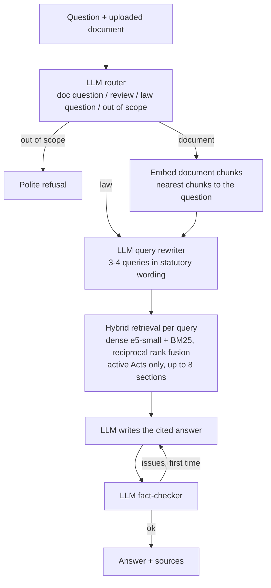
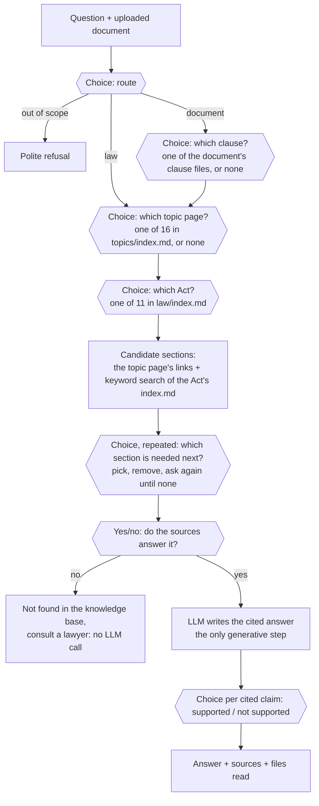
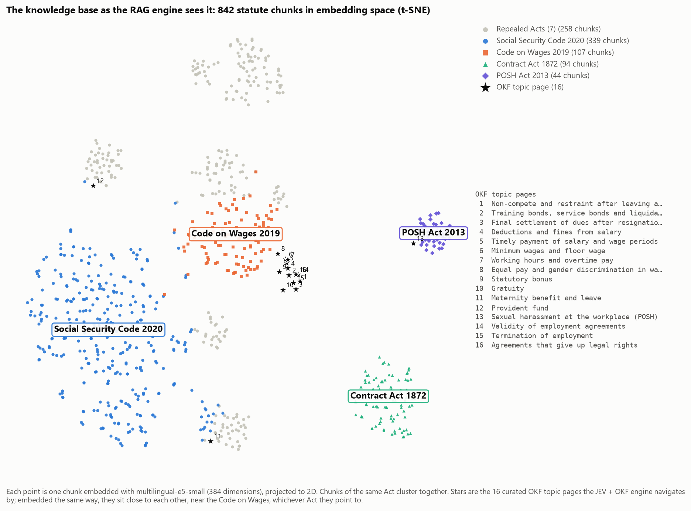
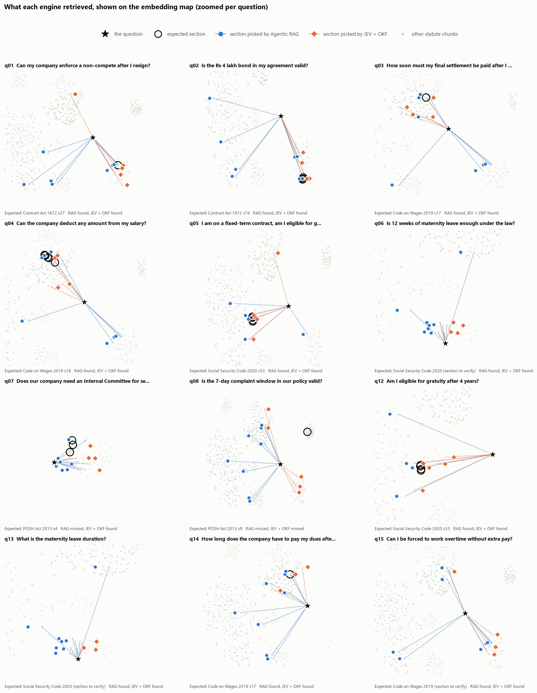
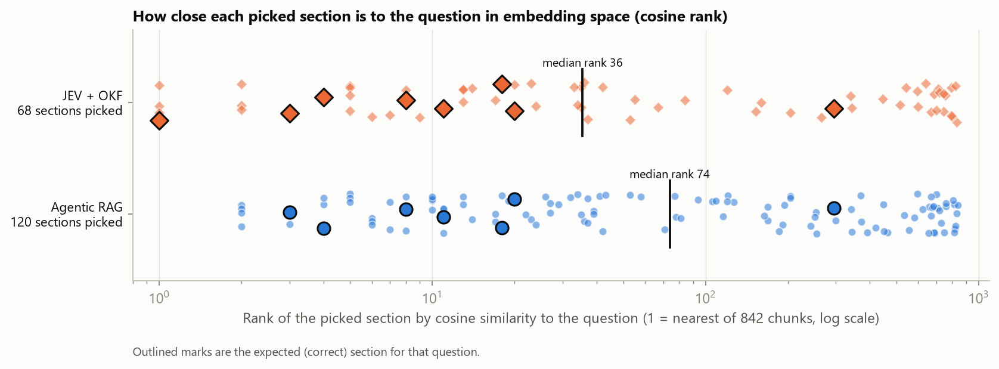
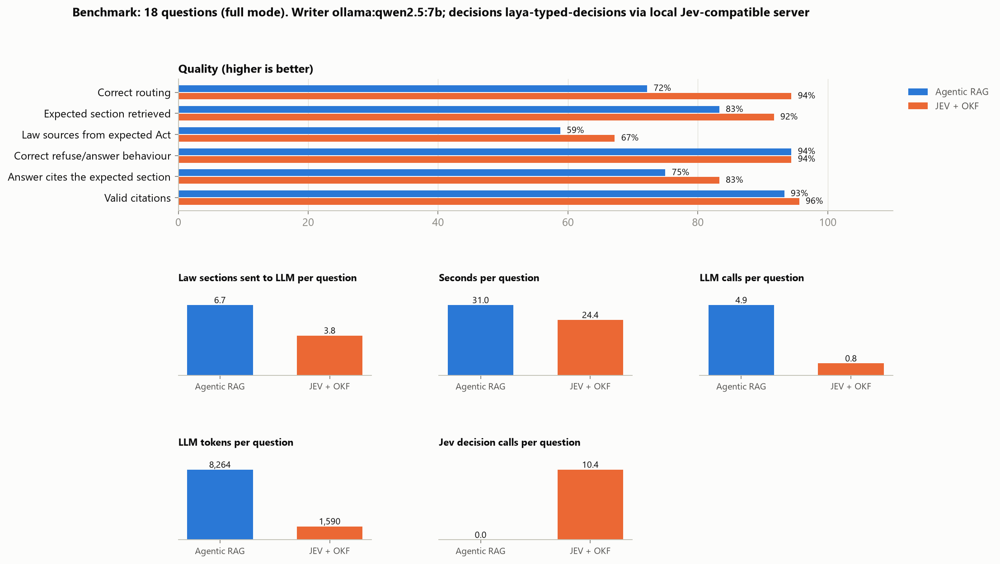
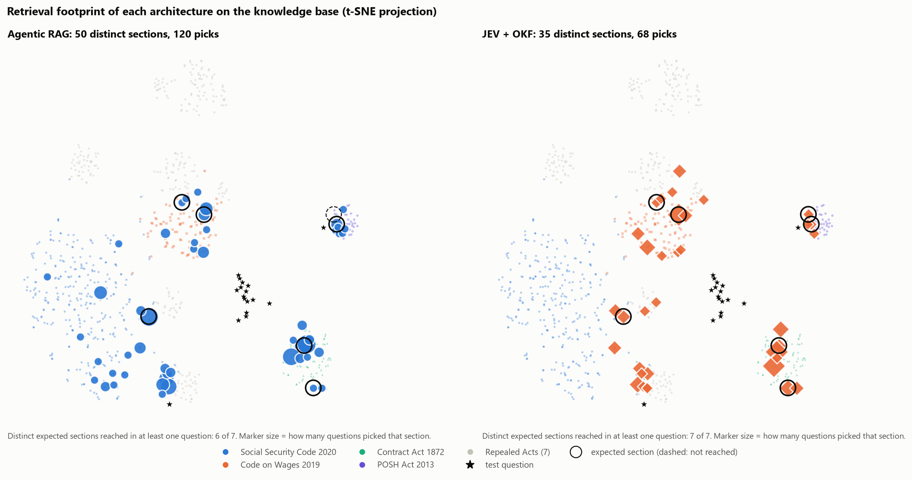
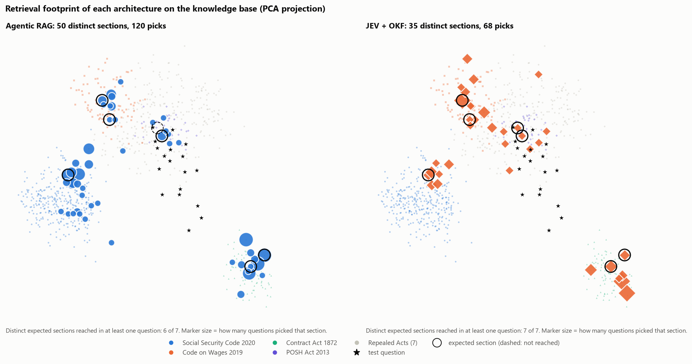
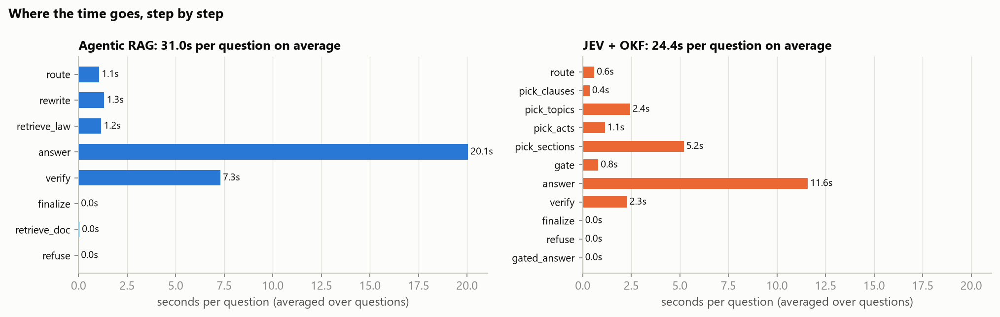
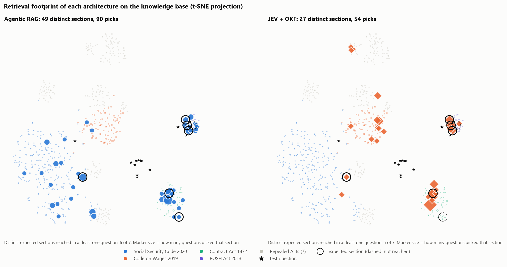

# Intelligent Analysis and Decision Support for Legal Documents Using Agentic AI

*An AI-agent-based framework for automated legal document analysis and decision support, applied to Indian employment law.*

A user gives the system an employment contract, offer letter or HR policy (PDF, DOCX, TXT and similar) and asks a
question such as *"Can my company enforce the non-compete after I resign?"*. The system acts as the user's law agent:
it finds the relevant clauses of the document and the governing sections of the statute, and writes a short answer
in which every claim cites its source: `[D#]` for the user's document, `[L#]` for the law.

The project builds **two agentic architectures** for this task and compares them on the same questions:

| | **Agentic RAG** (baseline) | **JEV + OKF** (proposed) |
|---|---|---|
| How the law is stored | 842 statute chunks in a vector index plus a BM25 keyword index | An **Open Knowledge Format (OKF)** bundle: 492 section files, 11 Act overviews, 16 curated topic pages, all linked and listed in `index.md` files |
| How law is found | Embedding similarity and keyword match, after the LLM rewrites the query | The agent reads the bundle top-down (topics and Acts, then sections, following links) |
| Who makes the intermediate decisions (routing, relevance, sufficiency, fact-checking) | The generative **LLM**, answering in JSON | A **System One decision model** (Jev-compatible) answering typed questions (Choice, yes/no, score) with probabilities |
| LLM calls per answer | 4 to 6 | 1 (2 if the self-check fails) |

No model is trained or fine-tuned. Pre-trained models are composed into agentic pipelines over a curated legal
knowledge base. Both engines use the same documents, the same answer-writing prompt and the same LLM, so differences
in quality and cost come from how knowledge is organised and who makes the decisions.

---

## 1. Knowledge and data

| Source | What it is | Used by |
|---|---|---|
| [`mratanusarkar/Indian-Laws`](https://huggingface.co/datasets/mratanusarkar/Indian-Laws) (Hugging Face) | 11 Indian employment Acts, **492 sections**, split into **842 chunks** (`data/corpus.jsonl`, built by `scripts/ingest.py`). 4 Acts in force, 7 kept for history and marked *repealed* with what replaced them | both |
| `data/emb.npy` | 842 chunk embeddings, `intfloat/multilingual-e5-small` (384 dimensions) | RAG |
| `knowledge/` | The OKF bundle compiled from the same 492 sections, plus 16 curated topic pages (`legal_agent/okf/topics.py`) | JEV + OKF |
| `data/samples/` | 7 **synthetic** HR documents (contracts, policies, a termination letter) with seeded issues, and an answer key | both, as user uploads |
| `data/samples/qa_testset.jsonl` | 18 test questions with the expected route, Act and section | evaluation |
| `data/real/` (git-ignored) | 3 **real** documents: Startup India non-compete template, SHRM India clause bank, MWCD POSH handbook | held-out check |
| `data/qa_real.jsonl` | 13 held-out questions on the real documents, written before any run | evaluation |

**Acts in force:** Code on Wages 2019 · Code on Social Security 2020 · Indian Contract Act 1872 · Sexual Harassment of
Women at Workplace (POSH) Act 2013.
**Repealed, kept for history:** Payment of Gratuity 1972 · Maternity Benefit 1961 · EPF 1952 · Payment of Wages 1936 ·
Minimum Wages 1948 · Industrial Disputes 1947 · Industrial Employment (Standing Orders) 1946.

### The test set

| Route | Questions | What it tests |
|---|---|---|
| Question about the uploaded document | 9 (q01–q09) | Finding the clause **and** the governing section, e.g. a non-compete → Contract Act s27 |
| Whole-document review | 2 (q10–q11) | Clause-by-clause checking |
| General question of law | 5 (q12–q15, q17) | Retrieval without a document |
| Out of scope | 2 (q16, q18) | Refusing politely (biryani, Python) |

12 questions have a known governing section; 4 should be refused or answered with "consult a lawyer".

### The OKF bundle

[Open Knowledge Format](https://cloud.google.com/blog/products/data-analytics/how-the-open-knowledge-format-can-improve-data-sharing)
(Google Cloud, v0.1, June 2026) stores knowledge as markdown files with YAML frontmatter. `type` is the only required
field, and `index.md` files list each folder's contents so an agent can read top-down ("progressive disclosure").

```
knowledge/
├── index.md                         entry point
├── log.md                           change history
├── topics/   index.md + 16 pages    "non-compete" → Contract Act s27, s23, s24 ...
├── law/      index.md
│   └── indian-contract-act-1872/
│       ├── index.md                 every section with a one-line description
│       ├── overview.md              type: Statute
│       └── s-027-agreement-in-restraint-of-trade-void.md    type: Statute Section
└── documents/<upload>/              each uploaded document, one file per clause (type: Contract Clause)
```

`python scripts/build_okf.py` rebuilds and validates the bundle: 519 concepts, 0 conformance problems.

**Fairness.** The topic pages translate everyday words into statutory wording ("non-compete" → "restraint of trade").
The RAG engine receives the same vocabulary hints in its query-rewriting prompt, so neither engine has knowledge the
other lacks.

---

## 2. The two architectures

### A. Agentic RAG (`legal_agent/pipelines/rag_agent.py`)



Every decision is a call to the generative LLM. Relevance comes from geometric closeness in vector space and keyword overlap.

### B. JEV + OKF (`legal_agent/pipelines/jev_okf_agent.py`)



Hexagons are **typed decisions** answered by the decision model, not the LLM. A topic chosen with confidence always
contributes its primary governing section, because curated OKF links are trusted knowledge.

**Why Choice.** The first version scored every candidate on a 0–3 scale and asked yes/no for every topic. A small local
decision model gave nearly the same score to everything (about 2.1 of 3 for gratuity, pregnancy dismissal and
"offences by companies" alike), so it fed the LLM the wrong law. Asking it to *pick one option from a list* is the
primitive it answers best. On the non-compete question this change took the engine from missing Contract Act s27 to
ranking it first, and cut decision tokens from 22,942 to 4,245.

### The decision model (`legal_agent/jev/engine.py`)

Jev is [TypeSafe AI](https://docs.typesafe.ai)'s "System One" model: it never generates text, it answers typed
questions with calibrated probabilities. The engine speaks Jev's API through the official `typesafe-sdk` and can point
at any backend with one line in `.env`:

| `JEV_BACKEND` | What answers the decisions | Notes |
|---|---|---|
| `server` (used for the results below) | **Laya** (`convaiinnovations/laya-typed-decisions`), an open-weight Jev-compatible model served on the laptop by [ollajev](https://pypi.org/project/ollajev/) | Free and private. Not Jev itself; less accurate, 1,024-token input limit |
| `typesafe` | TypeSafe's hosted Jev | Needs an approved key (waitlist) |
| `vercel` / `openrouter` | Hosted Jev through a gateway | Vercel's free monthly credit is enough for this project |
| `local` | Offline stand-in built from two small cross-encoders | Copies Jev's interface, not its accuracy |

In this report, "JEV + OKF" means the architecture: a Jev-compatible decision model over an OKF bundle. The
experiments used Laya, and the architecture is unchanged with TypeSafe's hosted Jev.

---

## 3. Running it

Prerequisites: Python 3.13 virtual environment in `.venv`, [Ollama](https://ollama.com) with `qwen2.5:7b`, and
ollajev with the Laya model.

```bat
cd Agent_Lex
.venv\Scripts\activate
pip install -r requirements.txt
```

**Terminal 1, the decision model** (leave it open, like Ollama):

```bat
set OLLAJEV_DEVICE=cpu
ollajev serve convaiinnovations/laya-typed-decisions --no-browser
```

**Terminal 2:**

```bat
python scripts\check_jev.py                         &REM one test decision
python scripts\ask.py --doc data\samples\02_noncompete_bond.docx "Can my company enforce the non-compete after I resign?"
python scripts\ask.py --pipeline jev_okf "What is the maternity leave duration?"
```

`ask.py` prints, for each engine, every step with its timing, the answer, its sources, and the cost
(LLM calls, LLM tokens, decision requests).

**The web app.** With Ollama and the decision model running, double-click `run_app.bat` (or run
`python webapp\server.py`). The browser opens at http://127.0.0.1:8600. Add a contract, offer letter or HR policy,
ask a question, and click any `L1` / `D1` citation to read the statute section or clause it relies on. The engine
(JEV + OKF or Agentic RAG) and the status of both models are under the settings button.

`.env` settings:

```
LLM_PROVIDER=ollama
OLLAMA_MODEL=qwen2.5:7b
JEV_BACKEND=server
JEV_BASE_URL=http://127.0.0.1:8000
JEV_MODEL=convaiinnovations/laya-typed-decisions
```

`.env` is git-ignored. `.env.example` lists every option.

---

## 4. Evaluation

```bat
python scripts\evaluate.py --retrieval-only    &REM routing and retrieval only (about 10 minutes)
python scripts\evaluate.py                     &REM also writes every answer (about 30 minutes)
python scripts\evaluate.py --testset data\qa_real.jsonl --docs data\real --tag real   &REM held-out real documents
python scripts\make_figures.py                 &REM figures from the latest report
```

Reports go to `reports/eval_<mode>.md`, `.json` and `.csv`; figures to `reports/figures/`.

**Manual grading.** The automatic metrics check *where* the law came from, not whether the explanation is legally
right. After a full run:

```bat
python scripts\grading_sheet.py make     &REM reports\grading_sheet.csv: both answers per question, labelled A and B in random order
python scripts\grading_sheet.py score    &REM after filling the scores: reports\grading_results.md
```

Score each answer 0–2 on three criteria: right law, right conclusion, and no invented facts.

| Metric | Meaning |
|---|---|
| Correct routing | The engine treated the question as the expected kind (document, review, law, out of scope) |
| Expected section retrieved | The governing section is among the law sources given to the LLM |
| Law sources from expected Act | Share of the law sources that come from the right Act (precision) |
| Correct refuse/answer behaviour | Refused exactly when it should (full mode) |
| Answer cites the expected section | The answer text cites the label of the governing section (full mode) |
| Valid citations | Share of `[D#]`/`[L#]` labels in the answer that point at a real source (full mode) |
| Seconds, LLM calls, LLM tokens, decision requests | Cost per question |

### Results

<!-- RESULTS:START -->
Retrieval mode, 18 questions, writer `qwen2.5:7b`, decision model Laya served locally (25 October 2026).
Reports: `reports/v1_choice/` and `reports/v2_choice/`.

| Metric | Agentic RAG | JEV + OKF v1 | JEV + OKF v2 |
|---|---|---|---|
| Correct routing | 72% | 94% | **94%** |
| Expected section retrieved (of 12) | 92% / 83% | 75% | **92%** |
| Law sources from the expected Act | 65% / 58% | 65% | **67%** |
| Law sections sent to the LLM | 6.7 | 3.6 | **3.8** |
| LLM calls before the answer is written | 1.9 | **0** | **0** |
| Seconds per question, retrieval only | **5.9–6.4** | 10.6 | 9.8 |

RAG shows two values where its two runs differ: its query rewriting is done by the LLM, which does not give the same
queries every run. In the second run it also missed the POSH complaint-window question.

Retrieval mode stops before the answer is written. The **full run**, in which every answer is written and checked
(v2, `reports/v2_full/`, re-scored in `reports/eval_full_rescored.md`):

| Metric | Agentic RAG | JEV + OKF |
|---|---|---|
| Correct routing | 72% | **94%** |
| Expected section retrieved | 83% | **92%** |
| Law sources from the expected Act | 59% | **67%** |
| Correct refuse / answer behaviour | 94% | 94% |
| Answer cites the expected section | 75% | **83%** |
| Valid citations | 93% | **96%** |
| Seconds per question | 31.0 | **24.4** |
| LLM calls per question | 4.89 | **0.83** |
| LLM tokens per question | 8,264 | **1,590** |
| Decision-model requests per question | 0 | 10.4 |

Two scoring rules were corrected after this run and applied identically to both pipelines' saved answers, with no
model called (`python scripts\evaluate.py --rescore reports\eval_full.json`): citations written as
`[L1, Section 17(2)]` had not been recognised, and an answer that answered and then suggested a lawyer had been counted
as a refusal. Under the original rules JEV + OKF scored 83% on refusal behaviour and 67% on citing the expected section;
RAG's figures were unchanged apart from valid citations (93% either way).

Each pipeline made one refusal mistake: RAG gave advice to "Should I sue my employer?"; JEV + OKF analysed "Was my
termination legal?" where it should have said this cannot be determined from the letter. On "Is 12 weeks of maternity
leave enough?" RAG's answer misread Section 60 and called 12 weeks sufficient; JEV + OKF's answer was correct (26 weeks,
at most 8 before delivery).

**Reading the results**

- **Routing.** The decision model's Choice between four request types is right on 17 of 18 questions. The LLM router
  treats several document questions as general law questions, so RAG often never reads the clause the user asked about.
- **Recall.** After v2, both engines find the governing section on 11 of 12 questions. JEV + OKF does it while sending
  the LLM about half as many sections, and its sections come from the right Act slightly more often.
- **Speed.** JEV + OKF is slower in retrieval mode (about 10 s against 6 s), because Laya runs on the laptop's CPU and
  answers one request at a time, about 8 requests per question. A hosted decision model, or a GPU, removes most of that.
  Counting the answer step, JEV + OKF makes one LLM call against RAG's three or more.

**How v1 became v2.** v1 asked the decision model which topic the *question* was about. Laya leaned towards
"Validity of employment agreements" whenever a question said "valid" or "enforce", and it rarely gave any option more
than 0.5 probability, so the rule "keep a topic's primary section above 0.5" almost never applied. v2 also asks which
topic each selected *clause* is about, and keeps the primary section of every topic the model actually chose (its top
pick), not only those above a fixed probability. Missed sections fell from 3 to 1. Because v2 was changed after seeing
v1's results on the same 18 questions, the v2 figures may be optimistic; the real-document test set is the check.

### Held-out check on real documents

Because v2 was adjusted after seeing v1's results, it was also tested on **13 new questions about three real documents**,
written before either engine was run on them (`data/qa_real.jsonl`):

- the Startup India *Confidentiality and Non-Compete Agreement* template (Government of India portal);
- the SHRM India *Clause Bank for Indian Employment Contracts*;
- the Ministry of Women and Child Development *Handbook on Sexual Harassment of Women at Workplace* (2015).

Figures: `reports/figures_real/`. The per-question report (`reports/eval_real_full.*`) quotes passages from these
documents, so it is not published here; with the documents in `data/real/`, the command in section 4 regenerates it.

| Metric | Agentic RAG | JEV + OKF |
|---|---|---|
| Correct routing | 92% | **100%** |
| Expected section retrieved (of 9) | **78%** | 67% |
| Law sources from the expected Act | **79%** | 73% |
| Correct refuse / answer behaviour | 92% | 92% |
| Answer cites the expected section | 67% | 67% |
| Valid citations | 100% | 100% |
| Seconds per question (r03 excluded, see below) | 44.4 | 45.1 |
| LLM calls per question | 4.4 | **1.0** |
| LLM tokens per question | 8,273 | **2,846** |
| Decision-model requests per question | 0 | 14 |

On unseen questions JEV + OKF **does not** retrieve the governing law more often than RAG; it is slightly behind. It
keeps the better routing and uses about a third of the LLM tokens. The traces show why it missed three sections: the
decision model again chose the topic "Validity of employment agreements" and the Code on Wages for questions about
breach compensation (Contract Act s73), a non-compete clause (s27) and a POSH penalty (s26), so those sections never
became candidates. That is the same bias seen in v1, now confirmed on held-out questions, and it was not tuned away.
Both engines failed the question whose law is not in the knowledge base (notice periods, Industrial Relations Code):
neither said the law was missing. In answer quality the picture is mixed. JEV + OKF answered the POSH penalty and
employer-duty questions correctly where RAG cited the wrong Act, and RAG answered the breach-compensation question
correctly where JEV + OKF did not.

Two notes on this run:
- *Timing:* the laptop went to sleep during question r03, so its JEV + OKF time (6,110 s) is excluded from the average
  (`reports/eval_real_full_timing.*`, written by `scripts/timing_clean.py`); the original report is unchanged.
- *Clause splitter:* the clause splitter was extended for headings written as "SECTION 3" followed by the title on the
  next line, after the real non-compete agreement split into only two clauses. This was done before any question was
  written or run. The synthetic documents split exactly as before.
<!-- RESULTS:END -->

### Figures

| | |
|---|---|
|  | **The knowledge base in embedding space.** 842 chunks projected with t-SNE: each Act forms its own cluster. The 16 OKF topic pages sit close together near the Code on Wages whichever Act they point to, which is why the JEV + OKF engine follows their *links* rather than their position. |
|  | **What each engine retrieved, per question.** The question (star), the expected section (ring), RAG's picks (blue) and JEV + OKF's picks (orange) on the same map. |
|  | **How close the picks are to the question in embedding space.** For each picked section, its rank by cosine similarity to the question (1 = nearest of 842 chunks). The correct sections (outlined) are usually within the 20 nearest chunks for both engines. Both also bring in sections far from the question: RAG through its rewritten queries and keyword search, JEV + OKF through topic links. JEV + OKF sends fewer and closer sections (median rank 36 against 74). On the real documents this reverses (106 against 26): see `reports/figures_real/`. |
|  | **Benchmark.** Quality metrics, and one panel per cost metric so different units never share an axis. |
|  | **Retrieval footprint of each architecture (t-SNE).** Every section each engine retrieved over the 18 questions: RAG 120 picks over 50 sections, JEV + OKF 68 picks over 35, concentrated near the governing Acts. |
|  | **The same on the PCA projection**, which keeps global distances. |
|  | **Where the time goes**, step by step, for each engine. |
|  | **Real documents: retrieval footprints.** RAG 90 picks over 49 sections; JEV + OKF 54 over 27, including a cluster in the Code on Wages from the decision model's topic and Act bias. |

**Interactive views.** `reports/figures/knowledge_map_3d.html` is a rotatable 3D map with the text of every section
on hover. For Google's [Embedding Projector](https://projector.tensorflow.org), click **Load** and choose
`reports/projector/vectors.tsv`, then `reports/projector/metadata.tsv`. Colour by *act* and run *T-SNE*.
`python scripts\build_projector.py` regenerates these files, and `python scripts\export_projector_tsv.py` writes
`visualization/`, with columns showing which engine retrieved each section (colour by `synthetic_picked_by` or
`real_picked_by`).

---

## 5. Project layout

```
legal_agent/
  config.py              settings from .env
  documents.py           loading PDF/DOCX/DOC/TXT/MD/HTML/RTF, splitting into clauses
  corpus.py              statute corpus, section titles
  llm.py                 LLM client with call, token and latency accounting
  metrics.py             per-question trace shared by both engines
  service.py             prepares uploads for both engines; one ask() for scripts and the web app
  rag/retriever.py       hybrid BM25 + dense retrieval
  okf/                   builder.py (compile bundle), reader.py (navigate, validate), topics.py (curated topics)
  jev/engine.py          decision engine: TypeSafe, Vercel, OpenRouter, local server, offline stand-in
  pipelines/             common.py (shared prompt), rag_agent.py, jev_okf_agent.py
  projector.py           embeddings and projections for the figures
webapp/                  server.py (local web server) and static/ (the page)
run_app.bat              starts the web app
scripts/                 ingest, build_okf, ask, check_jev, evaluate, timing_clean, build_projector,
                         export_projector_tsv, make_figures, grading_sheet, generate_samples
knowledge/               the OKF bundle (generated)
data/                    corpus.jsonl, emb.npy, samples/, qa_real.jsonl
reports/                 benchmark reports, figures/, figures_real/, projector/
visualization/           Embedding Projector files (vectors.tsv + metadata.tsv per folder)
```

---

## 6. Limitations

- **Decision model quality.** Laya is small and was tuned for agent traces, support tickets and invoices, not legal
  text. Its Choice answers are usable but not confident (top probabilities of 0.2–0.4), its yes/no answers sit near
  0.5, and ollajev warns that some of its confidence values are uncalibrated. Its claim checking is weak: it passed
  sentences that misstated the cited section. Results with TypeSafe's hosted Jev would differ.
- **Coverage.** The Industrial Relations Code 2020, the OSH Code 2020 and state Shops and Establishments Acts are
  not in the corpus, so questions about notice periods, retrenchment and termination procedure cannot be fully
  answered. On the synthetic set the engines said so; on the real-document notice-period question both answered
  anyway instead of saying the governing law is missing.
- **Tuned on the test set.** JEV + OKF v2 was changed after seeing v1's results on the same 18 questions. On the
  held-out real-document questions its retrieval advantage disappeared (67% against RAG's 78%), so the synthetic-set
  figures overstate it.
- **Run-to-run variation.** The LLM rewrites RAG's queries differently each run, so RAG's recall moved between 83% and
  92% across two identical runs. Report ranges, not single numbers.
- **Test documents.** 7 synthetic documents (18 questions) and 3 real ones (13 questions): enough to compare the
  designs, too few for strong statistical claims.
- **Local LLM.** `qwen2.5:7b` sometimes cites a label it was not given, or adds a condition the law text does not
  state. The valid-citation metric and the self-check measure this rather than hide it.
- **Scanned PDFs** need OCR first; only text-based PDFs are read.
- **Not legal advice.** Every answer ends with that disclaimer.

## 7. References

- TypeSafe AI, *Jev and the System One API*: https://docs.typesafe.ai
- Google Cloud, *Introducing the Open Knowledge Format* (June 2026): https://cloud.google.com/blog/products/data-analytics/how-the-open-knowledge-format-can-improve-data-sharing
- ollajev, local server for Jev-compatible decision models: https://pypi.org/project/ollajev/
- Laya typed-decisions model: https://huggingface.co/convaiinnovations/laya-typed-decisions
- Indian-Laws dataset: https://huggingface.co/datasets/mratanusarkar/Indian-Laws
- India Code, official texts of the Code on Wages 2019, Code on Social Security 2020 and Indian Contract Act 1872: https://www.indiacode.nic.in
- Wang et al., *Multilingual E5 Text Embeddings* (`intfloat/multilingual-e5-small`)
- Robertson and Zaragoza, *The Probabilistic Relevance Framework: BM25 and Beyond* (2009)
- Cormack et al., *Reciprocal Rank Fusion outperforms Condorcet and individual rank learning methods* (SIGIR 2009)
